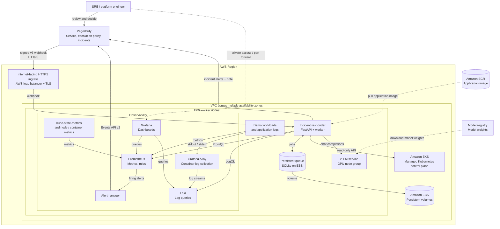

# AI Kubernetes Incident Responder

A small, human-in-the-loop incident analysis service. It receives authenticated
PagerDuty v3 webhooks, collects read-only evidence, asks a vLLM model for an
analysis, and posts the result as an incident note. It never runs remediation.

## Target architecture: AWS EKS

This is the **planned** AWS deployment, not a claim that the infrastructure
has already been provisioned. The repository currently contains the responder
application, examples, and a starter Helm chart. Monitoring, the AWS network,
ingress, GPU serving, and end-to-end integration are still to be set up and
validated. The diagram shows one cluster; it is not a highly available
production design.



The HTTPS ingress requires an ingress controller, a public DNS name and a
certificate; a Kubernetes Ingress resource alone does not provide these.
Nodes need appropriately controlled outbound access to PagerDuty, ECR and the
model registry. The exact subnet, NAT and endpoint design will be selected
before provisioning because it affects both security and cost.

The worker fetches PagerDuty incident alerts to find `namespace` and `pod`
labels. It collects namespace events and recent deployments, pod status,
pod CPU and memory metrics, and recent Loki logs. Evidence sources can fail
independently; failures and missing scope are included in the model input and
note. PagerDuty alert retrieval, inference, and note posting must succeed or
the job is retried.

Each installation assumes its Kubernetes credentials, Prometheus and Loki
refer to the same cluster. Route alerts from other clusters to separate
installations; cluster identity is not inferred from alert labels.

### End-to-end flow

1. Prometheus scrapes Kubernetes and workload metrics and evaluates alert rules.
2. Alertmanager groups an alert and sends it to the PagerDuty Events API v2.
3. PagerDuty opens an incident and sends a signed v3 webhook to the responder.
4. The responder verifies the signature, queues the event and retrieves alert
   details to determine the affected namespace and pod.
5. The worker collects Kubernetes evidence, Prometheus metrics and Loki logs,
   then sends bounded evidence to the internal vLLM chat-completions endpoint.
6. The model generates a hypothesis, supporting evidence and recommendations.
   The responder adds these and collection warnings as a PagerDuty note.
7. An SRE reviews the output and decides what, if anything, to do. The platform
   does not execute remediation.

### Guided build phases

1. Agree on the architecture, budget and prerequisites; create no resources.
2. Set up AWS access and local tooling; create the VPC, EKS cluster, managed
   node group, storage driver and kubeconfig.
3. Build and test the responder image, create an ECR repository and push it.
4. Install Prometheus, Grafana, Loki and Alloy; validate metrics and logs.
5. Configure PagerDuty, Alertmanager and the authenticated HTTPS webhook.
6. Provision a GPU node group and deploy vLLM with a suitable model.
7. Configure and deploy the responder with Helm; validate all connections.
8. Trigger controlled incidents and verify the full path; document cleanup.

The order may be adjusted after checking quotas, budget and the chosen
PagerDuty plan. In particular, the GPU node group should exist only while
needed for the demonstration. AWS resources incur charges, including the EKS
control plane even with zero worker nodes. Deleting a node group is not the
same as deleting the cluster; volumes, load balancers, addresses and image
storage can also remain billable. Production hardening requires a durable
shared queue, availability and recovery design, restricted network access,
secret management, and monitoring of the incident platform itself.

### EKS demo configuration under review

`infrastructure/eks/cluster.example.yaml` is a **non-production example** for
`ap-south-1`, with two public-subnet CPU nodes, no NAT gateway, and private and
public API endpoints. Its public API allowlist contains a documentation-only
IP address. **Do not create a cluster with this placeholder:** replace it with
a trusted current public IPv4 `/32` and verify your access before deployment.
The config does not deploy GPU nodes, the EBS CSI driver, an ingress controller,
monitoring, or vLLM; those require later stages and additional IAM and costs.

Kubernetes 1.34 was chosen for this temporary example to match the currently
installed kubectl 1.33 client within the supported one-minor version skew.
Its EKS standard-support end date is approaching; check current support and
tool compatibility before creating a cluster, and upgrade the client and
configuration for a longer-lived deployment. `eksctl` dry-run only validates
configuration locally; it does not prove that AWS permissions, quotas, IP
access, or EC2 capacity are sufficient. Review billing and approve deployment
before running any command that creates resources.

On Windows, `.\infrastructure\eks\prepare-local-config.ps1` can generate a
Git-ignored `cluster.local.yaml` using the public IPv4 address observed by
AWS's `checkip.amazonaws.com` endpoint. It never deploys anything and refuses
to overwrite an existing local configuration. The observed address is only
appropriate if it is the trusted egress address from which you will administer
the cluster; review it and update it if your internet connection or VPN changes.

## Prerequisites

Python 3.11–3.13, a Kubernetes cluster with kube-state-metrics and container
metrics, Prometheus, Loki, a running vLLM OpenAI-compatible chat endpoint, and
a PagerDuty service with API access. The model must support chat completions.
An existing Alertmanager-to-PagerDuty Events API v2 integration is required.
See `examples/alertmanager.yml` and `examples/alerts.yml` for starting points;
adapt metric names and grouping to your environment.

Configure a PagerDuty **v3 webhook subscription** for `incident.triggered`
pointing to `https://YOUR_HOST/webhooks/pagerduty`. Save the subscription's
signing secret. Use TLS and ingress/network controls to restrict access.
The `From` email must identify a PagerDuty user authorized to add notes; the
API token needs access to incident alerts and notes.
Prometheus queries assume cAdvisor's `container_cpu_usage_seconds_total` and
`container_memory_working_set_bytes` with `namespace` and `pod` labels. Loki
queries assume the same two stream labels; adapt `app/loki.py` if your
deployment uses different labels. Deployment and event lists are capped at
100 Kubernetes API results and are not an exhaustive audit history. Large
evidence sections are truncated for model input and reported in the note.

## Local setup

```powershell
python -m venv .venv
.\.venv\Scripts\Activate.ps1
pip install -r requirements.txt
Copy-Item .env.example .env
# Set the variables from .env.example in your shell; .env is not auto-loaded.
uvicorn app.main:app --host 127.0.0.1 --port 8000
```

For in-cluster use the Kubernetes service account is used; outside the cluster,
the default kubeconfig is used. Set `KUBECONFIG` if needed. `/healthz` is a
process liveness endpoint, not a check of external integrations.

## Configuration

All settings are environment variables; never commit secrets.

| Variable | Description |
|---|---|
| `PAGERDUTY_API_TOKEN` | PagerDuty REST API token |
| `PAGERDUTY_FROM_EMAIL` | Authorized PagerDuty user email |
| `PAGERDUTY_WEBHOOK_SECRET` | v3 webhook signing secret |
| `PROMETHEUS_URL` | Prometheus base URL |
| `LOKI_URL` | Loki base URL |
| `VLLM_BASE_URL` | vLLM base URL, e.g. `http://vllm:8000/v1` |
| `VLLM_MODEL` | Model name exposed by vLLM |
| `VLLM_API_KEY` | Optional API key for a secured vLLM endpoint |
| `PAGERDUTY_API_URL` | Optional REST base URL; defaults to `https://api.pagerduty.com` |
| `DATABASE_PATH` | SQLite file, defaults to `./data/jobs.db` |
| `HTTP_TIMEOUT_SECONDS` | Per-request timeout, defaults to 20 |
| `LOOKBACK_MINUTES` | Evidence window, defaults to 30 |
| `MAX_ATTEMPTS` | Maximum job attempts, defaults to 5 |

Set Alertmanager's `details` to include `namespace` and `pod` as shown in the
example. The worker reads these fields from each PagerDuty alert's
`body.details` (also accepting a `labels` mapping). Group by namespace and pod.
If there is no unambiguous scope, the service avoids broad cluster/log queries
and explicitly reports missing context. Alerts without a pod still get
namespace-level Kubernetes evidence. Verify the actual incident alert details
in your PagerDuty integration before production use.

## Kubernetes and Helm

Build and push the image using `docker build -t YOUR_REGISTRY/incident-responder:TAG .`.
Create the secret in the release namespace:

```sh
kubectl create secret generic incident-responder-secrets \
  --from-literal=pagerduty-token=... \
  --from-literal=pagerduty-from-email=... \
  --from-literal=pagerduty-webhook-secret=...
helm upgrade --install incident-responder ./helm/incident-responder \
  --set image.repository=YOUR_REGISTRY/incident-responder \
  --set image.tag=TAG
```

For a protected vLLM endpoint, add the optional `vllm-api-key` entry to that
Kubernetes secret. The chart and plain manifest load it as `VLLM_API_KEY`.
Edit the chart values for service URLs, model, persistence and ingress before
installing. The chart provides read-only cluster RBAC, a persistent volume,
and optional ingress. `k8s/` contains a plain-manifest alternative; edit its
image, URLs and secret references before `kubectl apply -f k8s/`.
Provision vLLM separately on GPU-enabled nodes; neither deployment installs a
GPU driver, model, Prometheus, Loki, or PagerDuty.

## Testing

```sh
pip install -r requirements-dev.txt
python -m pytest
helm lint ./helm/incident-responder
```

`examples/pagerduty-webhook.json` is a v3-shaped sample. It cannot be sent
unsigned: sign the exact request bytes with HMAC-SHA256 using the subscription
secret, and pass `X-PagerDuty-Signature: v1=<hex digest>`. Configure a real
PagerDuty incident and matching alert details to test the complete external
workflow.

## Operational and safety limits

Run **one application replica and one Uvicorn worker**, with a persistent
SQLite volume and a `Recreate` deployment strategy. The queue survives
restarts; failures retry with bounded exponential delay and are logged.
Exhausted jobs remain in SQLite with status `failed` and need operator
intervention; inspect the `jobs` table on the mounted volume (avoid exposing
the stored payloads). Delivery is at-least-once: a crash after PagerDuty accepts a
note but before the queue is marked complete can create a duplicate note.
Monitor application logs and failed jobs; no dashboard or automatic replay is
included. Webhook event IDs deduplicate repeated deliveries, not distinct
events for the same incident. Do not mount the SQLite volume on multiple
active replicas. A persistent volume outage prevents accepting webhooks, so
PagerDuty can retry.

Evidence and model output can contain sensitive data. Limit RBAC, network
access, model and PagerDuty access, and retention; use trusted endpoints and
TLS where appropriate. Logs and alerts are untrusted input, not instructions.
AI conclusions may be wrong; an SRE must review them before taking action.
